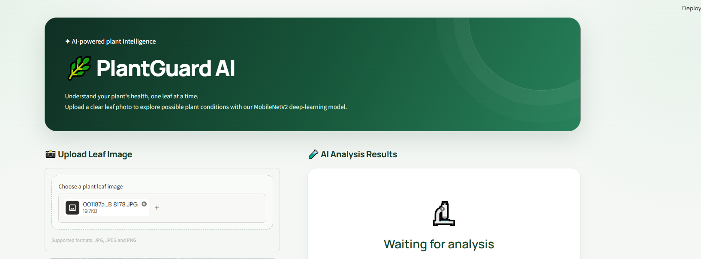
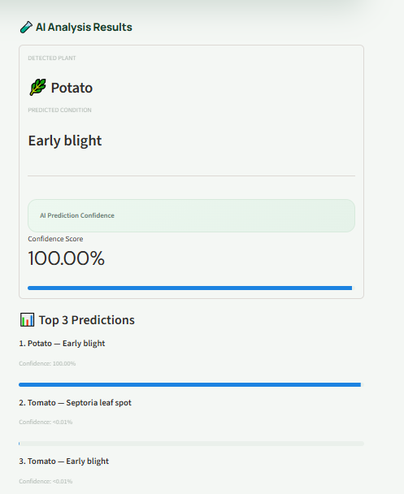
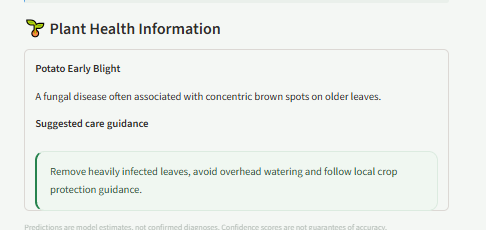
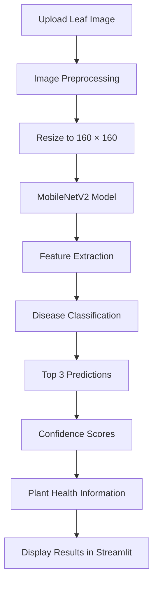
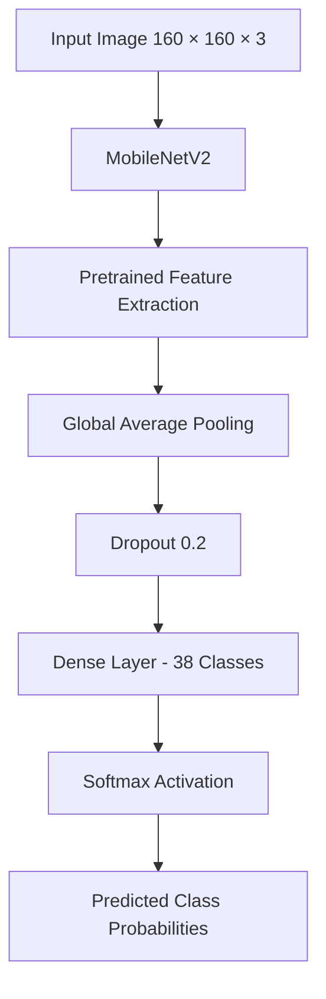

# 🌿 PlantGuard AI

### AI-Powered Plant Disease Detection Using Deep Learning

PlantGuard AI is a deep-learning-powered web application that analyzes plant leaf images and predicts possible plant diseases using **MobileNetV2** and **TensorFlow**.

Upload a leaf image, receive the model's top 3 predictions, view confidence scores, and explore plant health information through an interactive Streamlit interface.

---

## 📸 Application Screenshots

### Home Page


### Disease Prediction


### Plant Disease Information


---

## ✨ Features

- 🌱 AI-powered plant disease classification
- 🧠 MobileNetV2 transfer learning
- 📷 Leaf image upload and preview
- 🔍 Top 3 predicted plant conditions
- 📊 Prediction confidence scores
- 🌿 Plant disease information and care guidance
- ⚡ Interactive Streamlit web interface
- 📱 Responsive, user-friendly UI

---

## 🛠️ Technology Stack

| Technology | Purpose |
|---|---|
| Python | Core programming |
| TensorFlow / Keras | Deep learning |
| MobileNetV2 | Image classification |
| NumPy | Image processing |
| Pillow | Image loading and resizing |
| Streamlit | Web application |
| Matplotlib | Data visualization |
| Scikit-learn | Model evaluation |

---

## 🔄 Project Workflow



---

## 🧠 Model Architecture

PlantGuard AI uses MobileNetV2 with transfer learning and a custom classification head.



**Model configuration:**
- Architecture: MobileNetV2
- Transfer learning: ImageNet pretrained weights
- Input dimensions: 160 × 160 × 3
- Output classes: 38
- Optimizer: Adam
- Loss function: Sparse Categorical Crossentropy
- Batch size: 16
- Training epochs: Up to 5

---

## 📊 Dataset

The project uses the PlantVillage color image dataset.

| Detail | Value |
|---|---:|
| Total color images | 54,305 |
| Number of classes | 38 |
| Training images | 43,444 |
| Validation images | 10,861 |
| Split | 80% Training / 20% Validation |

The dataset is loaded using TensorFlow's `image_dataset_from_directory`.

**Note:** The dataset is not included in this repository. Download and organize it locally before training.

Expected dataset structure:

```text
dataset/
└── plantvillage dataset/
    └── color/
        ├── Apple___Apple_scab/
        ├── Apple___Black_rot/
        ├── Apple___healthy/
        └── ... 38 class folders
```

---

## 📈 Model Evaluation

| Metric | Result |
|---|---:|
| Validation Accuracy | **95.53%** |
| Validation Loss | **0.1308** |

The model was evaluated on the validation split used during training.

**Important:** Validation accuracy does not guarantee the same performance on real-world leaf photographs. Prediction confidence is not a measure of guaranteed diagnostic accuracy.

---

## 📂 Project Structure

```text
PlantGuard-AI/
│
├── assets/
├── models/
│   ├── plantguard_best.keras
│   └── class_names.json
│
├── screenshots/
│   ├── home.png
│   ├── prediction.png
│   └── disease-info.png
│
├── test_images/
├── utils/
│
├── app.py
├── train.py
├── predict.py
├── evaluate.py
├── requirements.txt
├── .gitignore
└── README.md
```

---

## 🚀 Installation and Setup

### 1. Clone the repository

```bash
git clone https://github.com/21vicky/PlantGuard-AI.git
cd PlantGuard-AI
```

### 2. Create a virtual environment

```bash
python -m venv venv
```

Activate it on Windows:

```powershell
venv\Scripts\activate
```

### 3. Install dependencies

```bash
pip install -r requirements.txt
```

### 4. Run the Streamlit application

```bash
streamlit run app.py
```

The application will open in your browser.

**Note:** The trained model (`plantguard_best.keras`) and class names file (`class_names.json`) must be present inside the `models/` directory to run the application.

---

## 🔬 Training the Model

After downloading and organizing the PlantVillage dataset:

```bash
python train.py
```

This trains the MobileNetV2-based classifier and saves the trained model and class names in the `models/` directory.

## 🔍 Evaluate the Model

```bash
python evaluate.py
```

## 🧪 Predict Using a Leaf Image

```bash
python predict.py
```

Enter the path to a leaf image when prompted.

---

## ⚠️ Disclaimer

PlantGuard AI is an educational AI project. Its predictions are intended for informational purposes and should not replace professional agricultural diagnosis. Model predictions may be incorrect, especially with poor-quality images or photographs outside the training dataset.

---

## 👨‍💻 Developer

**Vignesh U**

Full Stack Developer | Python | AI & Machine Learning

GitHub: [@21vicky](https://github.com/21vicky)

---

⭐ If you find this project interesting, consider giving the repository a star!
